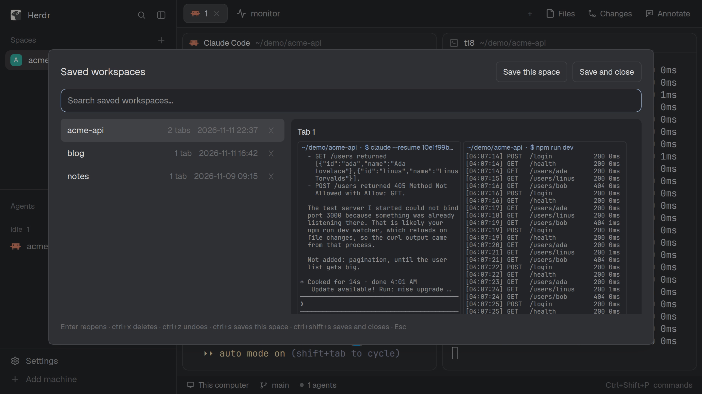
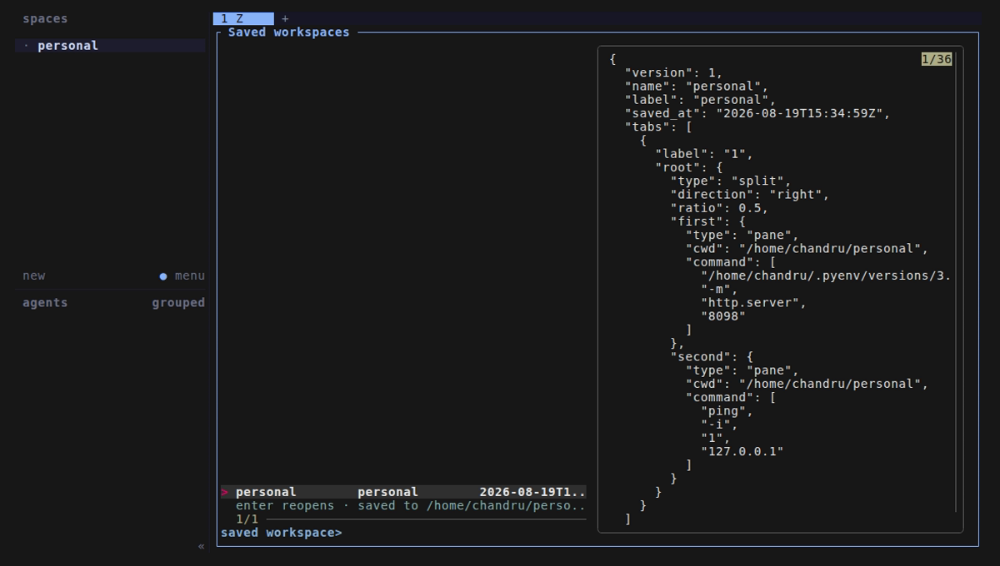
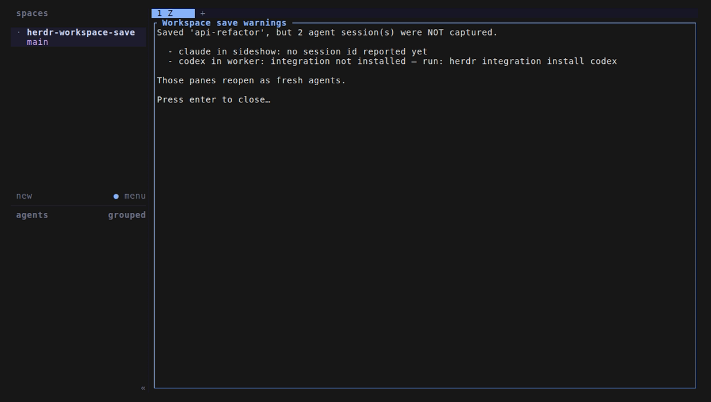

# herdr-workspace-save

Save a Herdr workspace (its layout, folders, agent sessions and running commands) and reopen
it later, as it was. There are two builds, one for the **Herdr desktop app** and one for the
**herdr TUI**. They install differently but read and write the same saves, so a workspace
saved in one opens in the other.

- [Herdr app](#herdr-app): a mod (`app/`), with a dialog that previews each save.
- [herdr TUI](#herdr-tui): a plugin (repo root), with an fzf picker.

## Why

Are you also guilty of using a ton of workspaces that you can't afford to close just yet? Doesn't the growing list ick your brain?
Then this is the perfect plugin for you :D

## Herdr app




### Install

Requires `herdr-app` with herdr-core (`hc`) on PATH, and `python3`.

Paste into an agent running in Herdr:

```text
Read ~/.config/herdr-app/AGENTS.md, then add this mod: github.com/chandrasekharan98/herdr-workspace-save/tree/main/app
```

Or by hand: copy `app/mods/workspace-save/` and `app/mods/workspace-save-now/` to
`~/.config/herdr-app/mods/`, and merge `app/keys.json` into `~/.config/herdr-app/keys.json`.
Keep the folder name `workspace-save`: both mods run `mods/workspace-save/wss.py`.

The mods run `python3` and `hc` on your machine (through `exec`). They read and write files
outside their folder: `~/.local/state/herdr/plugins/workspace-save/` (the saves) and
`~/.claude/sessions/` (read only, see [Agent sessions](#agent-sessions)).

### Use

| Key | What it does |
| --- | --- |
| `ctrl-b shift-s` | Save the shown space |
| `ctrl-b alt-w` | Open the Saved workspaces dialog |

In the dialog: type to search, Up/Down and Enter (or a click) reopen a save. `ctrl+x` (or ✕)
deletes the selected save and `ctrl+z` undoes it. `ctrl+s` saves the space under the dialog,
`ctrl+shift+s` saves it and closes the space; the two buttons at the top do the same. Esc
closes it.

Beside the list, a preview shows each tab of the selected save as it looked: its splits in
place, and in each pane its folder, the command reopening runs, and the screen text captured
when you saved (any program: agents, `btop`, editors). It's text, so colors aren't kept. The
preview only reads the save from disk. It runs no agent, so it spends no tokens.

Optional, in your own layout (see `app/RECIPE.md`, "Optional: space menu"): "Save
workspace", "Save and close" and "Open saved workspace…" when you right-click a space, and
"Open saved workspace…" when you right-click the empty part of the spaces panel. Shipped
layouts and mods can't be changed and a mod can't add items to another mod's menu, so these
need clones of the `spaces` and `menu` mods. To add them, ask your agent: "add the
workspace-save space menu items to my layout".

Results and warnings show as toasts. Reopening runs each pane's command at once: the app
can't type a command without pressing enter, the way the TUI does.

Not yet in the app: spaces on other machines, mod panes (Files, Changes) and split sizes.
Splits come back in the right places, but not at their saved sizes.

## herdr TUI


### Install

Requires `python3` and `fzf`.

```bash
herdr plugin install chandrasekharan98/herdr-workspace-save
```

Run `herdr server reload-config` afterwards if a server is already up.

For hacking on it locally, link the checkout instead:

```bash
herdr plugin link /path/to/herdr-workspace-save
```

### Use

Add to `~/.config/herdr/config.toml`, then `herdr server reload-config`:

```toml
[[keys.command]]
key = "prefix+shift+s"
type = "plugin_action"
command = "workspace-save.save"
description = "save workspace"

[[keys.command]]
key = "prefix+alt+w"
type = "plugin_action"
command = "workspace-save.open"
description = "open saved workspace"
```

| Action | What it does |
| --- | --- |
| `workspace-save.save` | Save the focused workspace. Slug comes from its label. |
| `workspace-save.save-close` | Save, then close the workspace. |
| `workspace-save.open` | Open the picker overlay; enter reopens the selection. |

Reopening rebuilds the tabs and splits, then **types** each pane's command into it without
running it. You press enter in the panes you actually want. Reopening a six-agent workspace
therefore costs nothing until you say so.

In the picker, `ctrl-x` deletes the selected save and `ctrl-z` undoes it. There is no
confirmation prompt, because a delete is not final: it moves the file to `workspaces/trash/`,
which keeps it for 7 days. `ctrl-z` restores the most recent delete first.



Run any manually with `herdr plugin action invoke <id> --plugin workspace-save`.
`python3 wss.py list` prints the save directory and one line per save.

## What gets captured

Per pane, in this order:

1. **Agent session.** In the TUI, Herdr already tracks a session ref for recognized agents
   (`{source, agent, kind, value}`); it is stored verbatim and armed as a resume command.
   In the app, Claude Code sessions only (see [Agent sessions](#agent-sessions)).
2. **Foreground command.** Whatever the pane is running (from `pane.process-info` in the
   TUI, `hc get`'s `foreground` in the app), TUI programs included, so `vim notes.md` and
   `htop` come back as themselves. A pane sitting at a shell prompt records nothing: a
   command that already exited is not recoverable. In the TUI a pipeline records only its
   first stage, and saving warns which stages were dropped.
3. **cwd**, always.

In the app, each pane's visible screen is also saved, as text, for the preview only; it is
not replayed on reopen. Anything on screen (a printed token, say) ends up in the save file.

Not captured: scrollback, env (Herdr's layout export doesn't expose it; `env` is honoured on
a TUI restore if you add it by hand), and anything a process holds only in memory.

## Agent sessions

Resuming an agent needs two things, and the plugin tells you which one is missing.

**1. A session ref for it.**

In the TUI, that comes from Herdr's state integration (`herdr integration status`). Agents
Herdr detects but ships no integration for (currently `gemini`, `agy`, `cline`, `kiro`,
`amp`, `maki`) can never be resumed; their panes reopen fresh. Saving warns per pane:

```
codex: integration not installed — run: herdr integration install codex
pi: integration outdated (v6 < v8) — run: herdr integration install pi
gemini: Herdr ships no state integration, sessions cannot be captured
claude: no session id reported yet, pane will reopen fresh
```

In the app, Herdr doesn't say which conversation runs in a terminal. For Claude Code the mod
reads `~/.claude/sessions/<pid>.json`, which Claude Code writes for every running session,
using the terminal's foreground pid from `hc get`. That needs no setup. It is Claude Code's
own file, not a documented interface, so there is an opt-in fallback: a `SessionStart` hook
that records each terminal's session. Add it to `~/.claude/settings.json`:

```json
{
  "hooks": {
    "SessionStart": [
      { "hooks": [{ "type": "command", "command": "sh ~/.config/herdr-app/mods/workspace-save/claude-session-start.sh" }] }
    ]
  }
}
```

The hook is one `sh` line. Outside a herdr-core terminal (`$HC_TERMINAL_ID` unset) it does
nothing. Inside one it appends a line to `~/.local/state/herdr/terminal-sessions.jsonl`:

```json
{"terminal":"t7","agent":"claude","session_id":"c1ba9b75-…","cwd":"/src/api","at":1794429282}
```

The last line for a terminal wins. Other mods can read the same file. It adds about 7 ms
to Claude Code's startup, which doesn't show above the run-to-run noise of `claude -p`
(7.56 s without, 7.37 s with, 5 runs each).

Other agents in the app are saved as their command line and reopen fresh, with a warning.

**2. A resume command must be known** for that agent. Defaults match Herdr's own internal
resume table: `--resume` for claude, codex (`codex resume`), grok, droid, devin, hermes,
cursor (`cursor-agent`), qodercli; `--session` for pi, opencode, kimi, kilo;
`--conversation` for agy; `--thread` for mastracode. Reopening warns when it can't resume:

```
copilot: no resume command known, opened fresh — add one to config.json
claude 11c3d682: transcript deleted, opened fresh — raise cleanupPeriodDays
mastracode: saved without a session id, opened fresh
```

`{ref}` is substituted with the agent's session id or path:

```json
{ "resume": { "claude": ["claude", "--resume", "{ref}"] } }
```

Put overrides in `$HERDR_PLUGIN_CONFIG_DIR/config.json`
(`herdr plugin config-dir workspace-save`). In the TUI, commands are armed, not run, so a
wrong flag is visible in the pane before you press enter.

For Claude, a saved session whose transcript no longer exists on disk opens a bare `claude`
instead of a resume that would only error. Claude Code deletes transcripts older than
`cleanupPeriodDays` (default 30) at startup, so raise that in `~/.claude/settings.json` if you
want month-old saved workspaces to still resume.

### Where TUI warnings show up

Herdr renders plugin stdout/stderr nowhere on screen, so warnings get their own overlay pane
that stays open until you press enter:



Reopening from the picker keeps that pane open the same way. A notification with the `request`
sound fires alongside, and `herdr plugin log list --plugin workspace-save` has the raw text.
A save with nothing to warn about opens no pane. The app shows the same warnings as a toast.

## Where saves live

Both use `~/.local/state/herdr/plugins/workspace-save/workspaces/<slug>.json`
(`$HERDR_PLUGIN_STATE_DIR/workspaces/` in the TUI).

If a saved `cwd` no longer exists (deleted worktree), the pane opens in your home folder;
reopening warns which paths were missing, so a `--resume` in the wrong directory doesn't go
unnoticed.

Saving a workspace whose name matches an existing save overwrites it; there is no versioning.
Rename the workspace first if you want two.

### Format

```json
{
  "version": 1,
  "name": "reviews",
  "label": "reviews",
  "saved_at": "2026-08-05T16:26:29Z",
  "tabs": [
    {
      "label": "1",
      "root": {
        "type": "split",
        "direction": "down",
        "ratio": 0.5,
        "first": { "type": "pane", "cwd": "/tmp", "command": ["npm", "run", "dev"] },
        "second": {
          "type": "pane",
          "cwd": "/src",
          "agent": { "source": "herdr:claude", "agent": "claude", "kind": "id", "value": "c1ba9b75-…" }
        }
      }
    }
  ]
}
```

`version` is the format version; both targets refuse a file with another one. `direction` is
`right` or `down`; the app saves its rows and columns as nested splits of this shape.
Hand-editable: delete a `command` you don't want re-armed, add `env`, retarget a `cwd`.

## How it's built

`wss.py` is the shared core. It lives in `app/mods/workspace-save/wss.py` so the app mod
carries it, and the root `wss.py` is a symlink to it for the TUI plugin.

- The TUI runs it through `herdr-plugin.toml` and talks to the herdr server socket.
- The app mods (`app/mods/workspace-save/main.js`, the dialog, and
  `app/mods/workspace-save-now/main.js`, the save key) run its `app-*` commands through
  `exec`. The preview is `wss.py app-preview`. Saving reads the split tree from herdr-core's `herdr-app` document
  (`hc connect`, `doc.get`) and each terminal from `hc get`. Reopening runs
  `herdr-app do space.new`, `tab.new`, and `pane.focus` + `terminal.open` for splits.

## Development

```bash
python3 test_wss.py
herdr-app check app/mods/workspace-save
herdr-app check app/mods/workspace-save-now
```

The tests cover the pure parts: key stripping, saved-to-live pane pairing, missing cwds,
command arming (stale transcript, unknown agent, no integration), the app's row/column to
split conversion, the order of `herdr-app do` calls on restore, and the transcript tail
(text messages only), and the preview's split tree with screens.

## License

MIT
