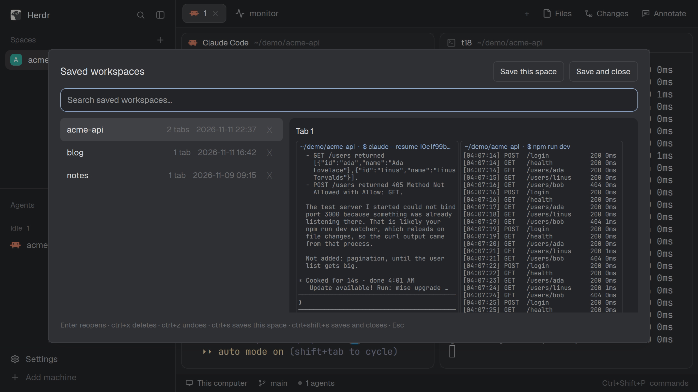

# Workspace Save

Save the shown space (its tabs, splits, folders, running commands and Claude Code
conversations) to a file, close it if you like, and reopen it later from a searchable
dialog. Saves are shared with the herdr TUI plugin of the same name, so a workspace saved
in one opens in the other.

## What you see

- **Saved workspaces** dialog (`ctrl-b alt-w`): 920px wide, 75% of the window high, on
  `popover`. A title row "Saved workspaces" in 15px semibold with two outlined buttons on
  the right: "Save this space" and "Save and close". Below it, a 36px search field with an
  `accent` border. Then the list, newest save first: one 12.8px row per save with its name,
  "N tabs", the save time (`YYYY-MM-DD HH:MM`, UTC) and a ✕. The selected row is on
  `selected`. The list is 340px wide; beside it, on `surface`, a preview of the selected
  save: each tab drawn as it was, its splits at their saved ratios, each pane a bordered box
  with a 10px caption (folder · the command reopening runs, in `accent`, or "shell") over the
  screen text captured when it was saved, in the terminal font, scaled to the pane's width.
  Saves made before screens were captured show the Claude conversation's last messages
  instead. A one-line hint in 11px `dim` at the bottom.
- **Right-click menus** (optional, need the person's own `spaces` and `menu` clones): on a
  space, "Save workspace", "Save and close" and "Open saved workspace…" above "Close"; on
  the empty part of the spaces panel, "New space" and "Open saved workspace…".
- **Saving workspace…** popup (`ctrl-b shift-s`): 260×44 at the top, for as long as the save
  takes (well under a second), then gone.
- Results are toasts: "Saved 'name'" with the file path, "Reopened 'name'", or a warning
  toast (15 s) listing what couldn't be captured or resumed.

## How it behaves

- The preview loads when a row is selected. It only reads the save (and, for older saves,
  `~/.claude/projects/*/<session id>.jsonl`) from disk: no agent runs, no tokens are spent.
  Screens are text, not pixels: colors aren't kept, every tab is covered, the window isn't
  touched.
- Typing filters by name. Up/Down move, Enter or a click reopens: a new space with the
  saved name, each tab with its name, each split in its direction, each terminal in its
  saved folder running its saved command. Claude Code panes run `claude --resume <id>`.
  The dialog shows "Reopening '…'" until it's done, then closes and selects the new space.
- `ctrl+x` or ✕ deletes the selected save; the hint line says so and `ctrl+z` undoes it
  (newest first). Deleted saves stay 7 days in `trash/`.
- `ctrl+s` / "Save this space" saves the space under the dialog and refreshes the list;
  `ctrl+shift+s` / "Save and close" saves it, closes the space (no confirmation) and the
  dialog. Esc closes the dialog.
- Saving a space whose name matches an existing save overwrites it.
- Agent statuses aren't shown; any agent can be saved, but only Claude Code conversations
  are resumed. Other agents are saved as their command line and reopened fresh, with a
  warning.

## Built from

- `mods/workspace-save/` (`place: "none"`, overlay `dialog` 920 × 0.75): the dialog.
  `mods/workspace-save-now/` (`place: "none"`, overlay `popup` at top, 260×44): runs one save
  of `focused().space`, then `closeOverlay(props().overlay)`. Both are opened only by
  `mod.open` from `keys.json`.
- The save popup takes props `{space?, close?}` (default: the focused space, no close).
- Both run `python3 ~/.config/herdr-app/mods/workspace-save/wss.py` through `exec`:
  `app-list` (JSON list), `app-preview <name>` (each tab's split tree; panes carry `run`, `screen`, `transcript`), `app-save <space id>` (prints `{path, label, warnings}`),
  `app-restore <name>` (prints `{space, label, warnings}`), `delete <name>`, `undelete`.
  `wss.py` is the herdr TUI plugin's script; the `app-*` commands are its Herdr app half.
- Capture: `hc connect` with `doc.get {name: "herdr-app"}` gives each tab's row/column tree
  of terminal blocks; `hc get <t> --json` gives each terminal's `foreground` argv, cwd and pid,
  and `hc read <t> --json` its screen text (stored as `screen {text, cols, rows}`). When
  `foreground` is a shell or missing (it is for btop), the shell's tty foreground group
  (`/proc/<pid>/stat`, `tpgid`) names the program.
  A row becomes a `right` split and a column a `down` split, folded into the TUI's binary
  `{type: "split", direction, ratio, first, second}` tree. Claude's session id comes from
  `~/.claude/sessions/<foreground pid>.json` (`sessionId`), else the hook's map (below).
- Restore: `herdr-app do space.new {name, tab, folder, argv}` for the first tab,
  `tab.new {space, name, folder, argv}` for the rest, and for each split `pane.focus {pane}`
  then `terminal.open {place: right|down, folder, argv}`. Pane ids come from `herdr-app ls`.
  `space.close {id, confirmed: true}` for save and close.
- Optional `claude-session-start.sh`: a Claude Code `SessionStart` hook, one `sh` line, that
  appends `{"terminal":$HC_TERMINAL_ID,"agent":"claude","session_id","cwd","at"}` to
  `~/.local/state/herdr/terminal-sessions.jsonl`.

## Optional: space menu

These live in the person's own layout, so they can't ship as files. Shipped layouts and mods
are read-only and a shared mod can't add items to another mod's menu. Add them only when
asked, in a layout the person already owns (`layout.clone {name: "main"}` first if they
don't have one):

1. `mod.clone {name: "spaces", as: "<x>"}` and `mod.clone {name: "menu", as: "<y>"}` (or use
   the person's existing clones). Point the layout's spaces block at `<x>`.
2. Space right-click: in `<x>`, open `<y>` in place of `menu` (220×320, room for three more
   items) and call `cx.stop_propagation()` first, so the panel's menu doesn't open too. In
   `<y>`, `case "space":`, insert before "Close":
   `["Save workspace", "workspace-save", {space: tg.id}]`,
   `["Save and close", "workspace-save", {space: tg.id, close: true}]`,
   `["Open saved workspace…", "mod.open", {name: "workspace-save"}]`; and in `choose`,
   `if (it[1] === "workspace-save") openOverlay({mod: "workspace-save-now", kind: "popup", at: "top", width: 260, height: 44, props: it[2]})`.
3. Panel right-click: on `<x>`'s root element add
   `.id("spaces-panel").on_mouse_down("right", () => openOverlay({mod: "<y>", kind: "popup", width: 220, height: 120, props: {tab: "spaces"}}))`,
   and in `<y>` add `case "spaces":` returning `["New space", "space.new", {}]` and
   `["Open saved workspace…", "mod.open", {name: "workspace-save"}]`.

Clones don't get Herdr's updates to those mods: re-clone and re-apply after an update.

## Watch out

- A mod can't import another mod's files, so the small `saveSpace` function is in both
  `main.js` files.
- Don't close the dialog before a job ends: closing a mod copy cancels its tasks. That's
  why the save key opens a popup instead of running headless.
- Don't use an invisible kept `kind: "window"` to receive keys: it blocks the mouse.
  `<mod>.<command>` keys reach only a loaded copy, so the keys use `mod.open`.
- `pane.split` takes no folder; `terminal.open` does, but splits the focused pane, so
  focus first.
- The app runs a restored command at once; it can't type it unsent like the TUI does.
- Spaces on other machines aren't saved yet (`app-save` refuses ids with a `machine/`
  prefix). Mod panes (Files, Changes) aren't saved. Split ratios are saved but not restored.
- `~/.claude/sessions/<pid>.json` is Claude Code's own file, not a documented interface; the
  hook is the fallback if it goes away.
- Assumes `python3` and `hc` on PATH.

## Done when

- `herdr-app check ~/.config/herdr-app/mods/workspace-save` and `…/workspace-save-now` pass;
  `herdr-app status` shows no errors.
- `python3 test_wss.py` prints `ok`.
- `ctrl-b shift-s` in a space with a split and a Claude Code pane toasts "Saved", and the
  file under `~/.local/state/herdr/plugins/workspace-save/workspaces/` has the split and a
  `claude` agent with the session id.
- `ctrl-b alt-w`, Enter on that save: a new space with the same tabs and split, the Claude
  pane resuming the same conversation.
- `ctrl+x` removes a row; `ctrl+z` brings it back.
- Selecting a save shows each tab's panes in their split, with the screens as they were.
